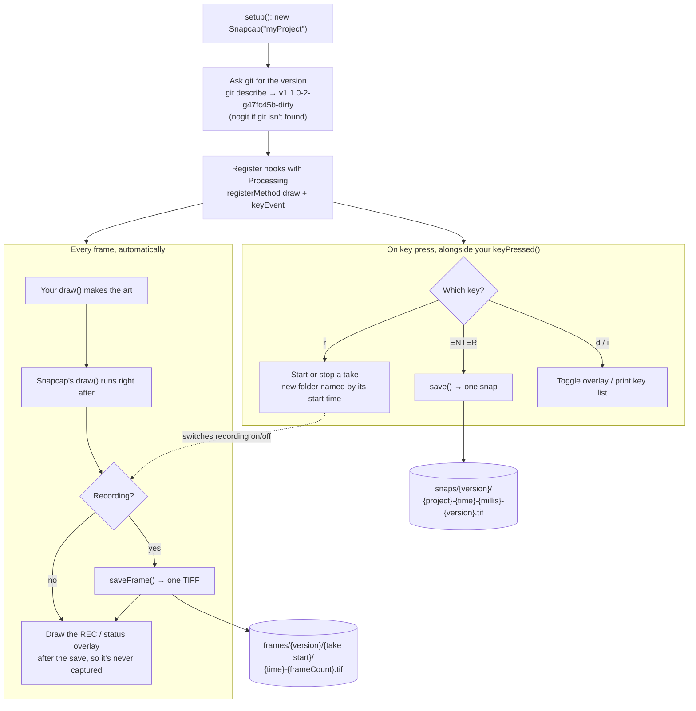

# snapcap
Frame recording utility.

A tool for recording, labeling, and organizing animation frames from Processing sketches.

## How it works



Snapcap runs on its own once it's created: Processing calls it after every `draw()` and on every key press. Frames are film, one folder per take, ready to turn into video. Snaps are stills, one flat folder per version. Both are labeled with the git version that made them.

## Use it in a sketch

Copy `snapcap_util/Snapcap.pde` into your sketch folder as a new tab, then add one line to `setup()`:

```java
Snapcap snapcap;

void setup() {
  size(1280, 480, P2D);
  snapcap = new Snapcap("myProject");
}

void draw() {
  // your art; no snapcap call needed
}
```

The version is read from git (`git describe --tags --always --dirty`), so output is labeled with the exact commit that made it, for example `v1.1.0-2-g47fc45b-dirty`. Outside a git repo it falls back to `nogit`. To set it by hand: `new Snapcap("myProject", "v2")`.

Snapcap hooks itself into the sketch with `registerMethod`, so it always captures after your `draw()` and reads keys without touching your `keyPressed()`.

| Key | Action |
| --- | --- |
| `r` | Start/stop recording a frame sequence |
| ENTER | Snap a single frame |
| `d` | Show/hide the on-screen status (never captured) |
| `i` | Print the key list |

Output:

- Snaps: `snaps/<version>/<project>-yyyymmdd-hhmmss-<millis>-<version>.tif`
- Frames: `frames/<version>/<start time>/yyyymmdd-hhmmss-#######.tif`, one folder per recording

Options (call in `setup()`): `setRecordKey('R')`, `keysOff()`, `setSnapRoot(path)`, `setFrameRoot(path)`.
