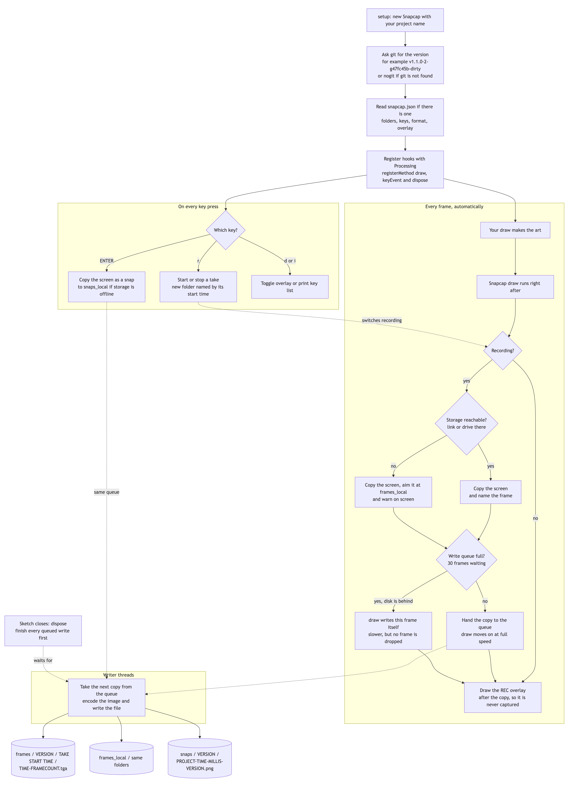
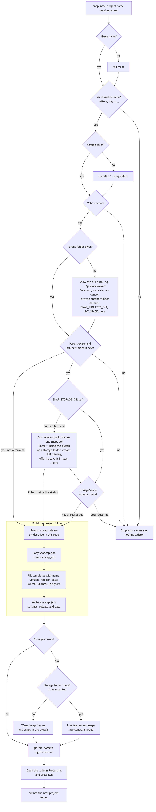
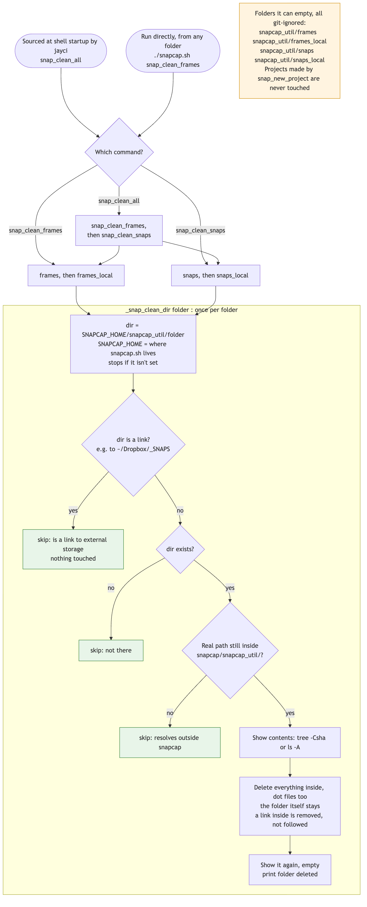

# snapcap
Frame recording utility.

A tool for recording, labeling, and organizing animation frames from Processing sketches.

## How it works



<sub>Source: [docs/diagrams/how-it-works.mmd](docs/diagrams/how-it-works.mmd). After editing it, run `bash docs/diagrams/render.sh`.</sub>

Snapcap runs on its own once it's created: Processing calls it after every `draw()` and on every key press. Frames are film, one folder per take, ready to turn into video. Snaps are stills, one flat folder per version. Both are labeled with the git version that made them.

## Help

```bash
snapcap --help        # with jayci; also snap_help
./snapcap.sh --help   # without jayci (or just ./snapcap.sh)
```

Lists the shell commands, the keys inside a sketch, and the settings, with the
current snapcap release at the top.

## Start a new project

`snap_new_project` is a build script that stamps out a ready-to-run Processing sketch with Snapcap already wired in. Think of it as a cookie cutter: `template/` is the cutter, and every project it makes comes out the same shape, with its own name and version pressed in.

```bash
source snapcap.sh                          # or via snapcap.cfg
snap_new_project myArt ~/sketches         # version is always v0.0.1
snap_new_project myArt v2.0.0 ~/sketches  # unless you give one
./snapcap.sh snap_new_project myArt        # also works without sourcing
```

### How the script runs



<sub>Source: [docs/diagrams/new-project.mmd](docs/diagrams/new-project.mmd). After editing it, run `bash docs/diagrams/render.sh`.</sub>

Step by step:

1. **Gather.** The name and parent folder come from the arguments; anything missing is asked for. The version is always `v0.0.1` unless you give one. For the folder, it shows the full path the project will get (for example `~/jaycode/myArt`) and asks you to press Enter, type `n` to cancel, or type a different folder. Then it shows where frames and snaps will go (see step 4) and asks you to confirm.
2. **Check.** It stops before writing anything if the name isn't a valid Processing sketch name, the version has characters that would break a folder name, the parent folder doesn't exist, the project folder already exists, or the storage folder already has a `<name>-media` folder (it asks before sharing it). Nothing gets overwritten.
3. **Build.** It copies `Snapcap.pde` and fills the files in `template/`, swapping `__PROJECT__`, `__VERSION__`, `__SNAPCAP_RELEASE__` and `__DATE__` for real values. Only the files a sketch needs are copied: no `.git`, demo layers or notes.
4. **Link storage.** The project (`<parent>/<name>`, code and git) and its media are kept in two different places. Media goes in `<storage>/<name>-media/frames` and `/snaps`, where `<storage>` is `SNAP_STORAGE_DIR` if you set one, otherwise `~/snapcap-media`. The script shows the full paths: press **Enter** to use them, **n** to keep frames and snaps inside the sketch folder instead, or type a different storage folder (it can save that one to jayci's `.jayrc` so it becomes the default). The sketch's `frames` and `snaps` folders become links to the media folders, so big image files stay out of the code: open `frames/` in the sketch and you see the real images. If `SNAP_STORAGE_DIR` points at a drive that isn't mounted, no links are made, nothing is created in its place, and output stays in the sketch. Run without a terminal (scripts, tests), only a set `SNAP_STORAGE_DIR` is used; `~/snapcap-media` is never created on its own.
5. **Version.** It runs `git init`, commits, and tags that first commit with the version. Snapcap reads its version from git, so the first frame you record is already labeled `v0.0.1`. Tag again (`git tag v0.0.2`) and new output gets the new label.
6. **Move in.** Your terminal ends up in the new project folder. (Run as `./snapcap.sh snap_new_project`, it prints the `cd` instead: a script can't move your terminal.)

What you get:

```
~/sketches/myArt/
    README.md            project name, version, snapcap release, date
    .gitignore           frames and snaps stay out of git
    myArt/myArt.pde      starter sketch, already calling new Snapcap("myArt")
    myArt/Snapcap.pde    copied from snapcap_util
    myArt/snapcap.json   settings, plus the snapcap release and date it came from
```

The sketch folder takes the project's name because Processing needs the folder and the main `.pde` to match. To change what every new project starts with, edit the files in `template/`. `bash tests/test_new_project.sh` checks the whole process, and CI runs it on macOS.

## Start fresh: clean the media folders

```bash
snap_clean_frames    # empties snapcap_util/frames and frames_local
snap_clean_snaps     # empties snapcap_util/snaps and snaps_local
snap_clean_all       # both
./snapcap.sh snap_clean_all   # also works without sourcing
```

These only empty snapcap's own media folders. A folder that's a link to external
storage (like `~/Dropbox/_SNAPS`) is skipped, and projects made by `snap_new_project`
are never touched.



<sub>Source: [docs/diagrams/clean.mmd](docs/diagrams/clean.mmd). After editing it, run `bash docs/diagrams/render.sh`.</sub>

## Use it in a sketch

Copy `snapcap_util/Snapcap.pde` into your sketch folder as a new tab, then add one line to `setup()`:

```java
Snapcap snapcap;

void setup() {
  size(1280, 480, P2D);
  snapcap = new Snapcap("myProject");
}

void draw() {
  // your art; no snapcap call needed
}
```

The version is read from git (`git describe --tags --always --dirty`), so output is labeled with the exact commit that made it, for example `v1.1.0-2-g47fc45b-dirty`. Outside a git repo it falls back to `nogit`. To set it by hand: `new Snapcap("myProject", "v2")`.

Snapcap hooks itself into the sketch with `registerMethod`, so it always captures after your `draw()` and reads keys without touching your `keyPressed()`.

| Key (default) | Action |
| --- | --- |
| `r` | Start/stop recording a frame sequence |
| ENTER | Snap a single frame |
| `d` | Show/hide the on-screen status (never captured) |
| `i` | Print the key list |

Output:

- Snaps: `snaps/<version>/<project>-yyyymmdd-hhmmss-<millis>-<version>.png`
- Frames: `frames/<version>/<start time>/yyyymmdd-hhmmss-#######.tga`, one folder per recording

### Settings: snapcap.json

Put a `snapcap.json` next to your `.pde` and Snapcap reads it at startup. `snap_new_project` writes one for every new project:

```json
{
  "snapcap": { "release": "v0.1-beta.0-9-gcec5a2c", "created": "2026-11-08" },
  "storage": {
    "frames": "./frames/",
    "snaps": "./snaps/",
    "framesLocal": "./frames_local/",
    "snapsLocal": "./snaps_local/"
  },
  "keys": { "enabled": true, "record": "r", "snap": "ENTER", "overlay": "d", "help": "i" },
  "format": { "frames": "tga", "snaps": "png" },
  "overlay": { "show": true }
}
```

| Field | What it does |
| --- | --- |
| `snapcap.release`, `snapcap.created` | The snapcap version and date the project was made from. A record only: Snapcap doesn't act on them. |
| `storage.frames`, `storage.snaps` | Where frames and snaps go. Relative to the sketch, or absolute, such as `/Volumes/Art/frames`. |
| `storage.framesLocal`, `storage.snapsLocal` | Where they go instead when storage can't be reached. |
| `keys.enabled` | `false` turns off all Snapcap keys. |
| `keys.record`, `keys.snap`, `keys.overlay`, `keys.help` | A single character, or `ENTER`, `SPACE` or `TAB`. |
| `format.frames`, `format.snaps` | `tif`, `tga`, `png` or `jpg`. Defaults: `tga` for frames (lossless, fastest to save, about half the size of TIFF) and `png` for snaps (lossless, smallest, opens anywhere). JPG is smallest but loses quality. |
| `overlay.show` | Whether the on-screen status starts visible. |

Every field is optional. Anything missing, misspelled or invalid keeps its default, and a sketch with no `snapcap.json` at all works exactly as before. The version is never in the file: it always comes live from git, so it can't go stale.

The sketch only reads `snapcap.json`; it never writes one. New projects get it from `snap_new_project`. For an older sketch, copy `template/snapcap.json` next to its `.pde` and remove the `snapcap` section, or keep it and fill it in by hand.

Options (call in `setup()`; they win over `snapcap.json`): `setRecordKey('R')`, `keysOff()`, `setSnapRoot(path)`, `setFrameRoot(path)`.

### When the storage drive is unplugged

If `frames/` or `snaps/` is a link to a drive that isn't mounted, the link points nowhere and saving there would fail. Snapcap checks first. It checks about once a second, at the start of every take and snap, and on every recorded frame. When storage can't be reached:

- frames go to `frames_local/` and snaps to `snaps_local/`, inside the sketch, with the same folder and file names
- the console prints `STORAGE OFFLINE` and says which folder is missing
- a yellow `STORAGE OFFLINE` bar shows on screen, even with the status hidden, and is never captured
- if the drive disappears in the middle of a take, the rest of that take goes to `frames_local/` under the same take folder

When the drive comes back, the console says so and new takes and snaps go back to storage. Anything saved locally stays in `frames_local/` and `snaps_local/` for you to move over. Both folders are in the new-project `.gitignore`. The same check covers an absolute root set with `setFrameRoot("/Volumes/MyDrive/frames")`: Snapcap never creates a stand-in folder for a missing drive.
